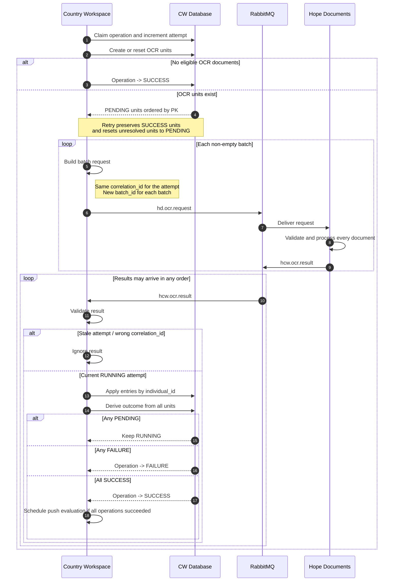
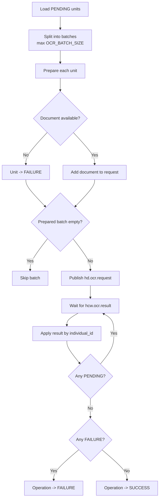

# OCR processing flow

OCR is executed across **Country Workspace (CW)**, **RabbitMQ**, and **Hope Documents (HD)**.

> **RabbitMQ batches are transport only. Persistent `RdpOperationUnit` records are the source of truth for OCR completion.**

Each eligible Individual has at most one OCR unit.

---

## End-to-end flow



Key rules:

- batches are independent and results may arrive out of order;
- CW applies results by `individual_id`, not batch order;
- `batch_index` and `batch_total` are not used for completion;
- no eligible OCR documents is a successful no-op;
- an HD document result with `status="error"` creates an OCR finding, but its unit still becomes `SUCCESS`.

---

## Batching and unit state



Unit semantics:

```text
PENDING  - result may still arrive
SUCCESS  - processing completed; duplicate results are ignored
FAILURE  - local unit work could not proceed
```

On retry, `SUCCESS` units are preserved and unresolved units are reset to `PENDING`.

---

## Batch identifiers

| Field | Meaning |
| --- | --- |
| `correlation_id` | One ID per OCR attempt, derived from `operation.id` and `attempt`. |
| `batch_id` | New UUID per transport batch. |
| `batch_index` | Informational batch number. |
| `batch_total` | Calculated before document preparation. |
| `individual_id` | Stable request/result identity. |

`batch_total` may be larger than the number of published batches because unavailable documents can make a prepared batch empty. This does not affect completion.

---

## Publish failures

CW publishes through `django-streaming`. The helper retries the same event once after resetting the streaming engine.

A final `publish() == False` does **not** prove that RabbitMQ rejected the message: Pika `basic_publish()` is used without publisher confirms, so delivery may be unknown.

Therefore failed-publish units remain `PENDING`:

```text
message reached RabbitMQ -> a late valid result may still arrive
message was lost         -> operation may remain RUNNING until manual retry
```

Retrying the same event can also produce duplicate delivery; duplicate results are safe because already-`SUCCESS` units are ignored.

---

## Manual retry

Manual retry means the operator considers the current attempt stuck.

```text
RUNNING attempt N
    -> mark attempt N FAILURE
    -> claim operation again
    -> attempt N+1
    -> preserve SUCCESS units
    -> reset unresolved units to PENDING
    -> publish with a new correlation_id
```

Late results from attempt N are ignored because their `correlation_id` is stale.

If several operations are retryable, `FAILURE` operations are retried first; a still-`RUNNING` OCR operation is restarted only when no operation is currently `FAILURE`.

---

## Hope Documents mapping

Hope Documents builds each result directly from the request batch and preserves the original `individual_id`:

```python
for item in payload.get("documents") or []:
    outcome = process_document(
        item["content"],
        item["pattern"],
        individual_id=item["individual_id"],
    )
    documents.append({"individual_id": item["individual_id"], **outcome})
```

It also preserves:

```text
correlation_id
rdp_id
batch_id
batch_index
batch_total
```

So the core model is:

```text
transport:  batches and RabbitMQ messages
state:      RdpOperationUnit records
identity:   individual_id
attempt:    correlation_id
```
