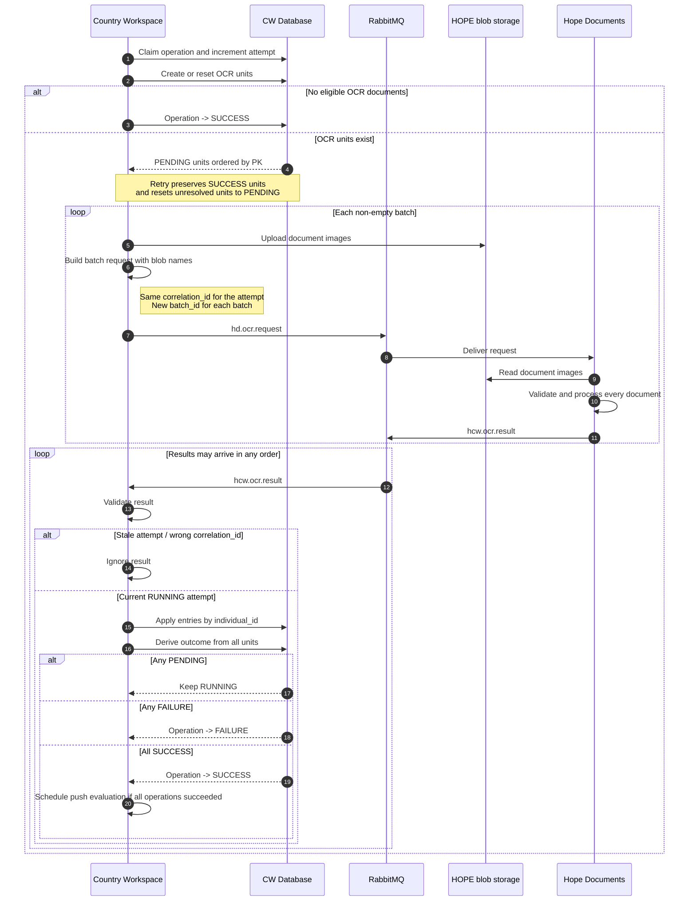
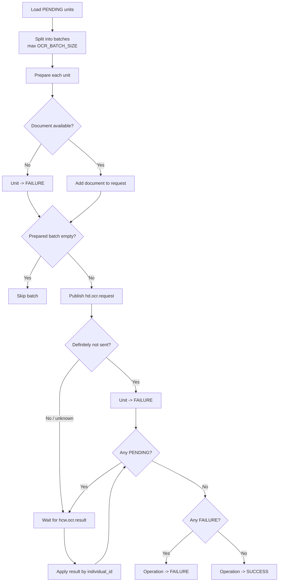

# OCR processing flow

OCR is executed across **Country Workspace (CW)**, **RabbitMQ**, and **Hope Documents (HD)**.

> **RabbitMQ batches are transport only. Persistent `RdpOperationUnit` records are the source of truth for OCR completion.**

Each eligible Individual has at most one OCR unit.

---

## End-to-end flow



Key rules:

- batches are independent and results may arrive out of order;
- CW applies results by `individual_id`, not batch order;
- `batch_index` and `batch_total` are not used for completion;
- no eligible OCR documents is a successful no-op;
- an HD document result with `status="error"` creates an OCR finding, but its unit still becomes `SUCCESS`.

---

## Batching and unit state



Unit semantics:

```text
PENDING  - result may still arrive
SUCCESS  - processing completed; duplicate results are ignored
FAILURE  - the document could not be prepared, or its result could not be applied
```

On retry, `SUCCESS` units are preserved and unresolved units are reset to `PENDING`.

---

## Batch identifiers

| Field | Meaning |
| --- | --- |
| `correlation_id` | One ID per OCR attempt, derived from `operation.id` and `attempt`. |
| `batch_id` | New UUID per transport batch. |
| `batch_index` | Informational batch number. |
| `batch_total` | Calculated before document preparation. |
| `individual_id` | Stable request/result identity. |

`batch_total` may be larger than the number of published batches because unavailable documents can make a prepared batch empty. This does not affect completion.

---

## Publish failures

CW publishes through `django-streaming`. The helper retries the same event once after resetting the streaming engine.

The publish outcome distinguishes:

- `SUCCESS` - publishing completed without an observed failure. This is not publisher-confirmed delivery.
- `NOT_SENT` - both attempts failed before RabbitMQ publishing started. The affected pending units are marked `FAILURE`.
- `UNKNOWN` - at least one attempt may already have reached RabbitMQ. The affected units remain `PENDING` so a valid late result can still be applied.

Because publisher confirms are not used, an `UNKNOWN` outcome cannot determine whether the message was delivered or lost.

If a publish failure leaves `PENDING` units, the operation remains `RUNNING` and may still receive results. If no `PENDING` units remain, the operation fails.

Retrying the same event can also produce duplicate delivery; duplicate results are safe because already-`SUCCESS` units are ignored.

---

## Manual retry

Manual retry means the operator considers the current attempt stuck.

```text
RUNNING attempt N
    -> mark attempt N FAILURE
    -> claim operation again
    -> attempt N+1
    -> preserve SUCCESS units
    -> reset unresolved units to PENDING
    -> publish with a new correlation_id
```

Late results from attempt N are ignored because their `correlation_id` is stale.

If several operations are retryable, `FAILURE` operations are retried first; a still-`RUNNING` OCR operation is restarted only when no operation is currently `FAILURE`.

---

## Document images

Images are not embedded in `hd.ocr.request`. As for biometric deduplication, CW uploads each document image to the shared HOPE blob container (`FILE_STORAGE_HOPE`, see [Blob Storage](../config/storage.md)) with `services.hope_blob.sync_record_blobs` and sends only the blob name:

```json
{"individual_id": 12345, "filename": "2024/afghanistan/CP-2024/CW_ind_12345_national_id_image.png", "pattern": "AB123456"}
```

The upload is scoped to the document image field, so the other image blobs of the Individual are left untouched, and an unchanged image is not uploaded again. A unit whose image references a missing file is marked `FAILURE`. A storage failure fails the whole attempt, which can then be retried.

Hope Documents must point its own `FILE_STORAGE_HOPE` at the same container, with read access. A blob it cannot read or decode becomes a document result with `status="error"`.

## Hope Documents mapping

Hope Documents processes each document in the request on its own and preserves the original `individual_id`. An unexpected exception from one document becomes that document's error result (`status="error"`). The other documents are still processed, and the batch result is still published.

Country Workspace treats that error result as a normal OCR outcome: it records an `OCR_ERROR` finding and marks the unit `SUCCESS`.

Hope Documents also preserves:

```text
correlation_id
rdp_id
batch_id
batch_index
batch_total
```

## Result items Country Workspace cannot apply

A problem with one result item does not reject the rest of the response.

| Item | What Country Workspace does |
| --- | --- |
| Invalid result for a known Individual | Marks that unit `FAILURE` and stores the other valid results. |
| Unknown or missing `individual_id` | Skips and logs the item. Units that were not matched stay `PENDING`. |
| Unit already `SUCCESS` | Ignores the item. |
| Unit already `FAILURE` | Skips the item and processes the others. |

When a valid result and an invalid item name the same Individual, the valid result is stored.

Envelope errors, such as a missing `correlation_id` or an empty document list, still reject the whole response.

So the core model is:

```text
transport:  batches and RabbitMQ messages
state:      RdpOperationUnit records
identity:   individual_id
attempt:    correlation_id
```
