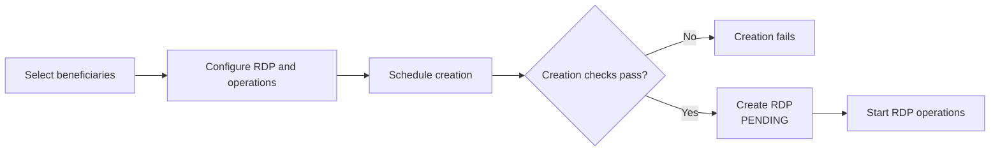

# Create an RDP

A **Registration Data Push (RDP)** contains beneficiary records selected for processing and transfer to HOPE Core.

RDPs are created within the selected **[Program](../program.md)** in the **[Analyst / Collector Workspace](../interfaces.md#analyst-collector-workspace)**.

## Before creating an RDP

Make sure that the required **Office** and **Program** are selected and that the beneficiary records are ready for RDP processing.

Country Workspace validates the records required for the RDP. Creation is blocked if no beneficiaries are selected, required records are invalid or conflict with an open or successful RDP, or another unfinished RDP already exists for the Program.

For household-based Programs, validation also covers the Individuals required for the push, including referenced collectors.

## Configure RDP processing

Select the beneficiary records and choose **Create RDP**.

The optional **Batch name** becomes the RDP name. If it is left blank, Country Workspace generates a name in the form `RDP YYYY-MM-DD HH:MM:SS`.

The creation page also shows configuration for the **[RDP operations](operations/index.md)** enabled for the Program. **[OCR](operations/ocr.md)** is always configured; **[biometric](operations/deduplication.md)** and **[biographic](operations/biographic-deduplication.md)** deduplication are included when enabled for the Program.

Each operation has its own review threshold, configured as **Number of findings** or **Findings rate**. The rate denominator depends on the operation.

See the operation-specific pages for threshold details and **[Review and Clean RDP](review.md)** for how thresholds affect the workflow.

## Create the RDP

After the configuration is submitted, Country Workspace schedules RDP creation. The background job validates the selection before saving the RDP.

If the checks succeed, Country Workspace creates the RDP in `PENDING`, links the selected beneficiaries, creates its configured operations, and starts processing automatically.

If a check fails, the RDP is not created and the failure is recorded in the background job.

## After creation

Configured operations run independently while the RDP remains `PENDING`.

After all operations complete successfully, Country Workspace evaluates their review thresholds. The RDP then either continues automatically toward the **[HOPE Core push](push.md)** or moves to `REVIEW_PENDING`.

See **[RDP operations](operations/index.md)** for operation processing, **[Review and Clean RDP](review.md)** for manual review, and **[Lifecycle and statuses](lifecycle.md)** for the complete state flow.
