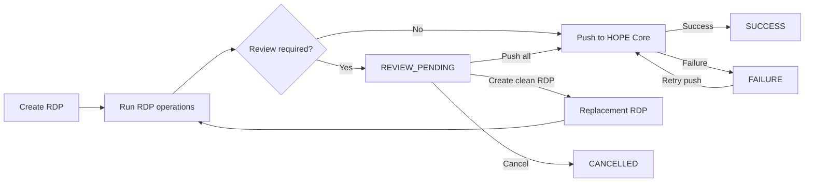

# Registration Data Pushes

A **Registration Data Push (RDP)** groups beneficiary records that are processed and pushed from Country Workspace to HOPE Core.

RDPs are managed within the selected **[Program](../program.md)** in the **[Analyst / Collector Workspace](../interfaces.md#analyst-collector-workspace)**.

## RDP workflow

Creating an RDP starts its processing automatically. Country Workspace runs the configured **[RDP operations](operations/index.md)** and continues only after they complete successfully.

If an operation threshold is exceeded, the RDP moves to `REVIEW_PENDING`. The user can then push all beneficiaries, create a clean replacement RDP, or cancel the RDP. See **[Review and Clean RDP](review.md)**.

If review is not required, the RDP continues automatically to the **[HOPE Core push](push.md)**.

See **[Lifecycle and statuses](lifecycle.md)** for the complete state flow.

## Create an RDP

Select the beneficiary records that should be processed together and use **Create RDP**.

Country Workspace validates the selection, creates the RDP, stores its operation configuration, and starts processing.

See **[Create an RDP](create.md)** for details.

## RDP operations

Country Workspace currently supports **[OCR](operations/ocr.md)**, **[biometric deduplication](operations/deduplication.md)** and **[biographic deduplication](operations/biographic-deduplication.md)**.

OCR is enabled for every Program. Biometric and biographic deduplication run when enabled in the Program configuration. Each operation has its own processing state, findings, recovery, and review threshold.

See **[RDP operations](operations/index.md)** for the common operation lifecycle.

## Review

After all configured operations complete successfully, Country Workspace evaluates their review thresholds independently.

Any exceeded threshold moves the RDP to `REVIEW_PENDING`; otherwise processing continues automatically.

See **[Review and Clean RDP](review.md)** for the available review decisions.

## Push to HOPE Core

When processing and any required review are complete, Country Workspace pushes the RDP beneficiary records to HOPE Core.

A failed push attempt changes the RDP to `FAILURE` and can be retried.

See **[Push to HOPE Core](push.md)** for the push workflow and recovery.

## Troubleshooting

See **[Troubleshooting](troubleshooting.md)** if RDP creation, operation processing, review, or push does not complete as expected.
