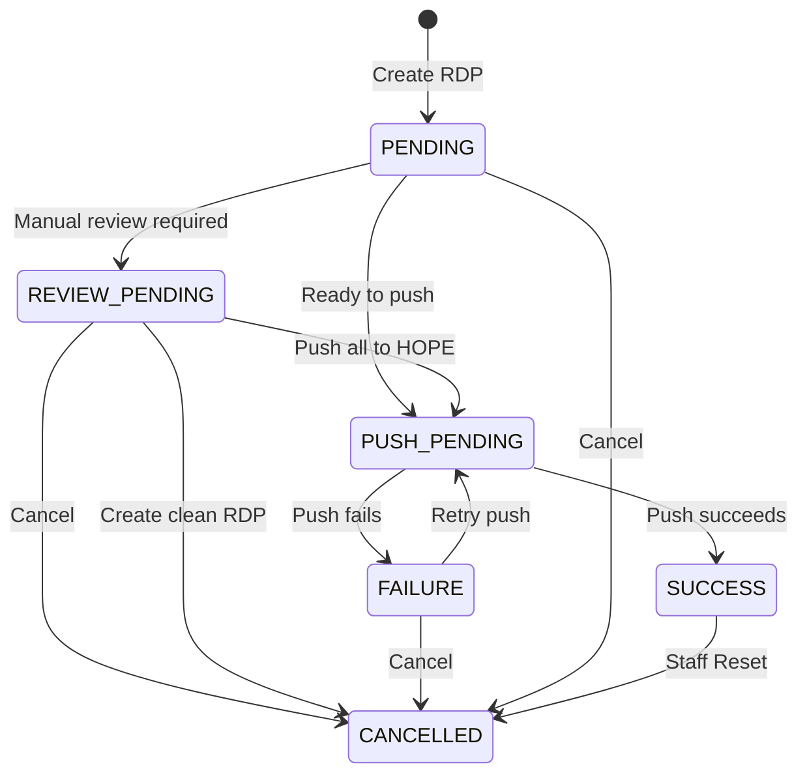

# Lifecycle and statuses

An **[RDP](index.md)** moves through a small set of statuses from creation to completion or cancellation.

The RDP status describes the overall Country Workspace workflow. Individual **[RDP operations](operations/index.md)** have their own statuses and recovery flow.

## RDP state flow

**Create clean RDP** cancels the reviewed RDP and creates a new `PENDING` RDP that starts its own processing. See **[Review and Clean RDP](review.md#create-clean-rdp)**.

## Statuses

| Status | Meaning |
| --- | --- |
| `PENDING` | The RDP is being processed before push. Operations may still be pending, running, or waiting for recovery. |
| `REVIEW_PENDING` | Processing completed successfully, but one or more operation thresholds require manual review. |
| `PUSH_PENDING` | A push to HOPE Core is in progress. This can include RDI reset, waiting for HOPE, and data transfer. |
| `SUCCESS` | The RDP push completed successfully. |
| `FAILURE` | The push attempt failed. The RDP can be retried when the required conditions are satisfied. |
| `CANCELLED` | The RDP was cancelled and no further processing is expected. |

Only one non-terminal RDP can exist for a Program at a time. `PENDING`, `REVIEW_PENDING`, `PUSH_PENDING`, and `FAILURE` are non-terminal statuses.

## Processing and review

A newly created RDP starts in `PENDING` while Country Workspace runs its configured **[RDP operations](operations/index.md)**.

An operation failure does not change the RDP to `FAILURE`; the RDP remains `PENDING`. Failed or otherwise recoverable operations can use **Retry operations**.

After all configured operations complete successfully, Country Workspace evaluates their review thresholds. If no threshold is exceeded, the RDP moves to `PUSH_PENDING` and the HOPE Core push starts automatically. Otherwise, it moves to `REVIEW_PENDING`.

From `REVIEW_PENDING`, the user can **Push all to HOPE**, **Create clean RDP**, or **Cancel RDP**. See **[Review and Clean RDP](review.md)** for the complete review flow.

## Push status changes

When the RDP is ready to be pushed, its status changes to `PUSH_PENDING`.

The RDP remains `PUSH_PENDING` while Country Workspace prepares HOPE Core, waits for HOPE when necessary, and sends beneficiary data.

A successful push changes the RDP to `SUCCESS`. A failed push attempt changes it to `FAILURE`; use **Retry push to HOPE** to start another push attempt.

See **[Push to HOPE Core](push.md)** for the complete push workflow.

## Recover a stuck push

If an RDP remains in `PUSH_PENDING` because the push can no longer continue, authorized staff can use **Fail stuck push** in Staff Administration.

Use this recovery action only after confirming that the push preparation job is no longer running and, when applicable, that the HOPE callback is no longer expected.

Country Workspace allows recovery only for the active push attempt when its preparation job exists and the data-push job has not yet been scheduled. Successful recovery changes the RDP to `FAILURE`.

**Fail stuck push** is a temporary recovery action and is expected to be removed when automatic recovery is available.

See **[Retry a failed push](push.md#retry-a-failed-push)** and **[Troubleshooting](troubleshooting.md)** for further recovery guidance.

## Cancel an RDP

**Cancel RDP** is available for RDPs in `PENDING`, `REVIEW_PENDING`, or `FAILURE`.

Cancellation is blocked while an RDP operation is `RUNNING`. For biometric and biographic RDPs, Country Workspace must also verify that the associated DedupEngine set can be safely handled; cancellation fails if its state cannot be handled or verified. When cancellation succeeds, the set is rejected when required. If the RDP is linked to a HOPE RDI, Country Workspace asks the user to confirm that the RDI has been deleted manually in HOPE before cancellation continues. Operations that have not started yet do not block cancellation.

Cancellation from `REVIEW_PENDING` is one of the **[review decisions](review.md#review-decisions)**. See **[Biometric deduplication](operations/deduplication.md#deduplication-set-lifecycle)** and **[Biographic deduplication](operations/biographic-deduplication.md#dataset-lifecycle)** for DedupEngine cleanup.

## Staff Reset

In **[Staff Administration](../interfaces.md#staff-administration)**, the latest `SUCCESS` RDP for a Program can be reset.

Reset marks the related beneficiary records as not removed and changes the RDP from `SUCCESS` to `CANCELLED`.

Staff Reset changes Country Workspace state only. It does not reverse processing already completed in HOPE Core.

## Processing flow

For the end-to-end interaction between RDP operations, external processing services, review, and HOPE Core, see **[RDP processing flow](processing.md)**.
