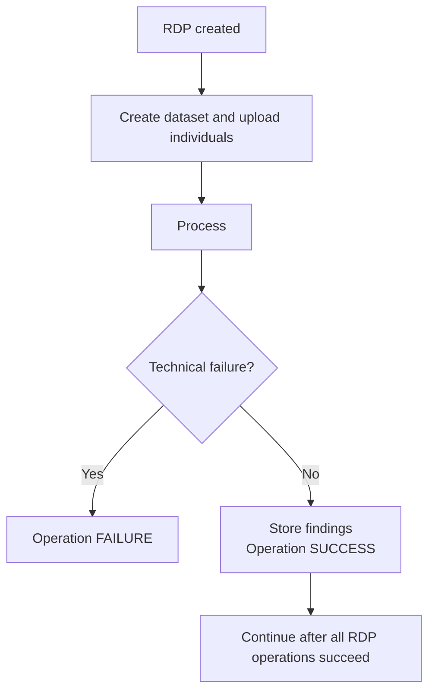

# Biographic deduplication

Biographic deduplication compares beneficiary personal data (names, birth date, phone numbers and similar) to find people who are likely the same person. It runs before an **[RDP](../index.md)** can be pushed to HOPE Core.

It runs as an **[RDP operation](index.md)** when biographic deduplication is enabled for the selected Program. It can be enabled together with **[biometric deduplication](deduplication.md)**; both use the same DedupEngine connection and the same RDP lifecycle.

## Requirements

- The Program must have **Biographic deduplication enabled**. Unlike biometric deduplication, this flag is not synchronized from HOPE; an administrator sets it in the Program admin.
- Country Workspace reuses the DedupEngine connection of biometric deduplication (`DEDUP_API_URL` and `DEDUP_API_TOKEN`). The token must carry the **API Biographic** grant in DedupEngine.
- The Program needs a `code`, because DedupEngine addresses biographic data by business area and Program code.

## Configuration

When creating an RDP, Country Workspace shows the biographic deduplication settings for Programs where this operation is enabled.

The biographic findings threshold can be configured as **Number of findings** or **Findings rate**. Unlike the other operations, it counts **Individuals with duplicates**: when two people match each other, DedupEngine reports the pair from both sides, but each person is counted once. The rate is calculated per 100 Individuals represented by the RDP. The default is `0`.

The matching sensitivity (duplicate score and maximum hits) is configured in DedupEngine, not in Country Workspace.

See **[Create an RDP](../create.md)** for the RDP creation flow and **[Review and Clean RDP](../review.md)** for threshold-based review.

## Data sent to DedupEngine

For every Individual in the RDP, Country Workspace sends:

| Field | Source |
| --- | --- |
| `full_name` | The `full_name` field, falling back to the Individual name |
| `given_name`, `middle_name`, `family_name` | Individual fields of the same name |
| `birth_date` | The `birth_date` field, when it is a valid date |
| `phone_no`, `phone_no_alternative`, `sex`, `relationship` | Individual fields of the same name |

Empty values are sent as empty. A `birth_date` that is not a valid date is dropped, and the person is still matched by the remaining fields.

An Individual without a name cannot be matched and is skipped. If no Individual in the RDP has a name, the operation fails before any data is sent.

External collectors are not included in biographic deduplication.

## Processing

Biographic deduplication starts automatically after the RDP is created.

Country Workspace creates (or resumes) a DedupEngine dataset for the operation, uploads the Individuals in batches and starts processing. DedupEngine assigns the dataset ID, which is stored on the operation and shown as **Dataset ID**. Re-sending an Individual replaces its previous record, so an interrupted upload is safe to resume.

The operation remains `RUNNING` while DedupEngine processes the dataset. DedupEngine calls back Country Workspace when the state changes; when the dataset is deduplicated, Country Workspace retrieves and stores the findings and the operation becomes `SUCCESS`.

A technical failure and a finding are different outcomes. Duplicates are valid results, so the operation can complete with `SUCCESS`.

See **[RDP operations](index.md)** for the common operation lifecycle and **[RDP processing flow](../processing.md)** for how operations join the overall workflow.

## Findings

Every biographic finding is a `DUPLICATE`. Each finding records:

| Detail | Meaning |
| --- | --- |
| Score | How closely the two people match. |
| Proximity to score | How far the match is from the configured duplicate score. |
| Matched in | `batch`: the match is another Individual of the same RDP. `population`: the match is an already approved Individual of the Program. |
| Matched person | The name and birth date DedupEngine matched. |

Country Workspace links the matching Individual when it exists locally in the same Program. A match that is not known locally is kept as a finding without a link and shows the DedupEngine reference of the matched person.

Biographic findings use the shared **[RDP Findings UI](index.md#findings-and-review)** and are summarized on the relevant Individual and Household pages.

## Review

After all configured RDP operations complete successfully, the biographic threshold is evaluated independently from the thresholds of other operations. The RDP requires manual review when any threshold is exceeded.

**Create clean RDP** can remove the beneficiaries affected by biographic findings, on either side of a match, together with findings selected from other exceeded operations. For household-based Programs, the whole Household is excluded when any actual member is affected.

See **[Review and Clean RDP](../review.md)** for the review and replacement-RDP flow.

## Dataset lifecycle

DedupEngine allows only one dataset to be processed per Program at a time, and approved datasets form the population that later RDPs are compared with.

- When an RDP is cancelled, Country Workspace rejects its dataset when required, so it is never matched against again. If the dataset is still being processed, cancellation is blocked.
- If **Create clean RDP** is used, the source dataset is rejected before processing of the replacement RDP continues.
- After a successful HOPE Core push, Country Workspace attempts to approve the dataset. An approval failure is recorded in the operation log but does not change the RDP from `SUCCESS`.

See **[Push to HOPE Core](../push.md#after-a-successful-push)** for the final push step.

## Failed biographic operation

If processing cannot start or complete, the operation changes to `FAILURE` while the RDP remains `PENDING`.

The failure reason is shown in the RDP **Operations** section. Use **Retry operations** after the cause has been resolved; the existing dataset is reused.

A biographic operation that is still `RUNNING` is not manually restarted because DedupEngine may still be processing it.

See **[Operation statuses](index.md#operation-statuses)** and **[Troubleshooting](../troubleshooting.md)** for recovery guidance.

## Operation details

The RDP **Operations** section shows the biographic operation status, Dataset ID, timing, attempts, configuration, errors, execution log, saved finding count, and affected Individual count.

See **[Operation details](index.md#operation-details)** for the common presentation.

## Clean Program data

!!! warning "Biographic data in DedupEngine is not cleared"
    **Clean program data** deletes the biometric Deduplication Set Group in DedupEngine, but it cannot do the same for biographic data. DedupEngine has no API to delete or reset the biographic population of a Program: its datasets can only be approved, rejected or canceled one by one, and approved Individuals stay in the Program's index.

    After a Program is cleaned and its data is imported again, new RDPs are therefore still compared with the Individuals approved before the cleanup, which can produce `population` duplicates that no longer exist in Country Workspace.

Until DedupEngine provides a group-level reset, the biographic population has to be removed in DedupEngine by its administrators.

Clearing it from Country Workspace requires a group-level reset or delete endpoint in the DedupEngine biographic API, addressed by business area and Program code like the existing dataset endpoints. Once available, it would be called from the Program cleanup job next to the biometric group deletion.
