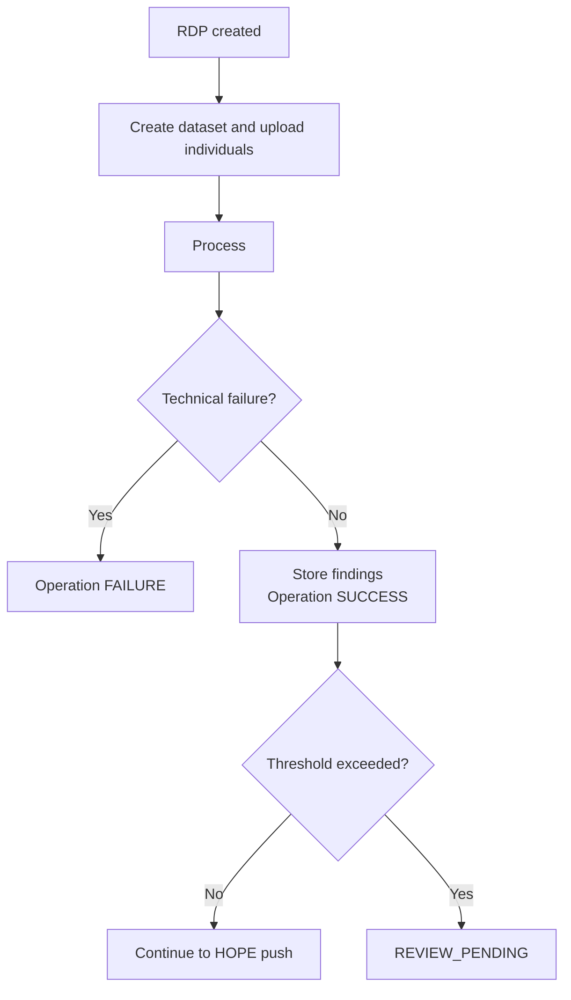

# Biographic deduplication

Biographic deduplication compares beneficiary personal data (names, birth date, phone numbers and similar) to find people who are likely the same person. It runs before an **[RDP](../index.md)** can be pushed to HOPE Core.

It runs as an **[RDP operation](index.md)** when biographic deduplication is enabled for the selected Program. It works like **[biometric deduplication](deduplication.md)** and can be enabled together with it.

## Requirements

- The Program must have **Biographic deduplication enabled**. Unlike biometric deduplication, this flag is not synchronized from HOPE; it is set in the Program admin by an administrator.
- Country Workspace reuses the DedupEngine connection of biometric deduplication (`DEDUP_API_URL` and `DEDUP_API_TOKEN`). The token must carry the **API Biographic** grant in DedupEngine.
- The Program needs a `code`, because DedupEngine addresses biographic data by business area and Program code.

## Configuration

When creating an RDP, Country Workspace shows the biographic deduplication settings for Programs where this operation is enabled.

The **biographic threshold** controls when the RDP requires manual review. It can be configured as **Number of individuals with duplicates** or **Individuals with duplicates per 100 RDP individuals**. The default threshold value is `0`.

The threshold counts **individuals**, not findings. When two people of the same RDP match each other, DedupEngine reports the pair from both sides, but each person is counted once.

The matching sensitivity (duplicate score and maximum hits) is configured in DedupEngine, not in Country Workspace.

## Data sent to DedupEngine

For every Individual in the RDP, Country Workspace sends:

| Field | Source |
| --- | --- |
| `full_name` | The `full_name` field, falling back to the Individual name |
| `given_name`, `middle_name`, `family_name` | Individual fields of the same name |
| `birth_date` | The `birth_date` field, when it is a valid date |
| `phone_no`, `phone_no_alternative`, `sex`, `relationship` | Individual fields of the same name |

Empty values are sent as empty. A `birth_date` that is not a valid date is dropped, and the person is still matched by the remaining fields.

An Individual without a name cannot be matched and is skipped. If no Individual in the RDP has a name, the operation fails before any data is sent.

External collectors are not included in biographic deduplication.

## Processing

Biographic deduplication starts automatically after the RDP is created.

Country Workspace creates (or resumes) a DedupEngine dataset for the operation, uploads the Individuals in batches and starts processing. Re-sending an Individual replaces its previous record, so an interrupted upload is safe to resume.

The operation remains `RUNNING` while DedupEngine processes the dataset. DedupEngine calls back Country Workspace when the state changes; when the dataset is deduplicated, Country Workspace retrieves and stores the findings and the operation becomes `SUCCESS`.

A technical failure and a finding are different outcomes. Duplicates are valid results, so the operation can complete with `SUCCESS`.

If both biometric and biographic deduplication are enabled, the RDP requires manual review when **either** threshold is exceeded.

## Findings

Every biographic finding is a duplicate. Each finding records the **score** and the **scope** of the match:

| Scope | Meaning |
| --- | --- |
| `batch` | The match is another Individual in the same RDP. |
| `population` | The match is an already approved Individual of the Program. |

For a finding, Country Workspace links the matching Individual when it exists locally in the same Program. A match that is not known locally is kept as a finding without a link.

Biographic results are shown on the relevant Individual and Household pages and lists:

- Individuals list: **Biographic duplicate** column and **Biographic duplicates** filter.
- Households list: **Biographic duplicate members** column and filter, counted over actual members.
- Individual page: the matching Individuals with their score and scope.

## Manual review

If the threshold is not exceeded, the RDP continues automatically to the **[HOPE Core push](../push.md)**. If it is exceeded, the RDP moves to `REVIEW_PENDING` and the user can **Push all to HOPE**, **Create clean RDP**, or **Cancel RDP**. See **[Biometric deduplication](deduplication.md#manual-review)** for the review flow, which is the same.

## Create clean RDP

**Create clean RDP** creates a replacement RDP without beneficiaries affected by biographic findings (and biometric findings, when both operations ran).

For people-only Programs, affected Individuals are excluded. For household-based Programs, the whole Household is excluded when any actual household member is affected.

The original RDP is changed to `CANCELLED` and its DedupEngine dataset is rejected. The replacement RDP keeps the configured operations, but their thresholds are reset to **0**, so any finding requires manual review again.

## Approval and rejection

DedupEngine allows only one active dataset per Program, and approved datasets form the population that later RDPs are compared with.

- After the HOPE push succeeds, Country Workspace approves the dataset. An approval failure is recorded in the operation log but does not change the RDP from `SUCCESS`.
- When an RDP is cancelled (including **Create clean RDP**), Country Workspace rejects the dataset so it is never matched against again. If the rejection fails, the cancellation job fails and is reported in the RDP processing history.

## Failed biographic operation

If processing cannot start or complete, the operation changes to `FAILURE` while the RDP remains `PENDING`. The reason is shown in the RDP **Operations** section. Use **Retry failed operations** to run it again; the existing dataset is reused.

See **[Operation statuses](index.md#operation-statuses)** for the common retry behavior.

## Limitations

- Biographic data in DedupEngine is not cleared by **Clean program data**, because DedupEngine has no API to delete a biographic dataset.
- If the callback from DedupEngine is lost, the operation stays `RUNNING`; there is no automatic recovery yet (the same as for biometric deduplication).
