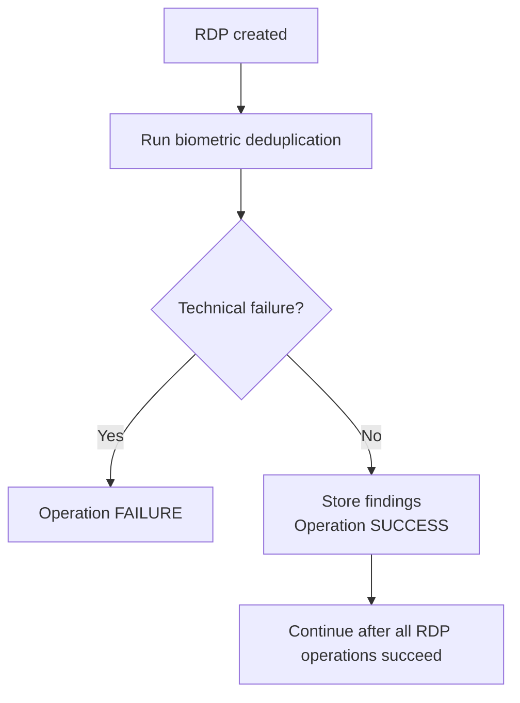

# Biometric deduplication

Biometric deduplication checks beneficiary photos for duplicate people and image-related problems before an **[RDP](../index.md)** can be pushed to HOPE Core.

It runs as an **[RDP operation](index.md)** when biometric deduplication is enabled for the selected Program.

## Configuration

When creating an RDP, Country Workspace shows biometric deduplication settings for Programs where this operation is enabled.

The biometric findings threshold can be configured as **Number of findings** or **Findings rate**. The rate is calculated per 100 Individuals represented by the RDP. For household-based Programs, this means actual Household members; external collectors are not included.

See **[Create an RDP](../create.md)** for the RDP creation flow and **[Review and Clean RDP](../review.md)** for threshold-based review.

## Processing

Biometric deduplication starts automatically after the RDP is created.

Country Workspace checks for beneficiary photos, creates or resumes the corresponding Deduplication Set in DedupEngine, uploads the available photos, and starts processing.

The biometric operation remains `RUNNING` while DedupEngine processes the set. When processing completes, Country Workspace retrieves and stores the findings.

If the RDP contains no usable biometric photo, the operation cannot start successfully.

A technical failure and a biometric finding are different outcomes. A technical failure changes the operation to `FAILURE`; biometric findings are valid processing results, so the operation can still complete with `SUCCESS`.

See **[RDP operations](index.md)** for the common operation lifecycle and **[RDP processing flow](../processing.md)** for how operations join the overall workflow.

## Findings

Biometric findings include duplicate people and image-related issues such as `FILE_NOT_FOUND`, `NO_FACE_DETECTED`, `FACE_NOT_ACCEPTED`, `BAD_IMAGE_QUALITY`, and `MULTIPLE_FACES_DETECTED`.

All of these findings participate in the biometric review threshold.

For a duplicate finding, Country Workspace links the related Individual when a matching local record is available in the same Program. The related Individual can be outside the current RDP.

If the related Individual later becomes unavailable locally, the finding is preserved and can still show the original DedupEngine counterpart reference.

External collectors are not included in biometric deduplication.

Biometric findings use the shared **[RDP Findings UI](index.md#findings-and-review)** and are summarized on relevant Individual and Household pages.

## Review

After all configured RDP operations complete successfully, the biometric threshold is evaluated independently from the thresholds of other operations.

If it is exceeded, biometric findings participate in the common RDP review. **Create clean RDP** can remove beneficiaries affected by biometric findings together with findings selected from other exceeded operations.

See **[Review and Clean RDP](../review.md)** for the review and replacement-RDP flow.

## Deduplication Set lifecycle

When a biometric RDP is cancelled, Country Workspace rejects its Deduplication Set when required.

If **Create clean RDP** is used and biometric deduplication is configured, the source Deduplication Set is rejected before processing of the replacement RDP continues.

After a successful HOPE Core push, Country Workspace attempts to approve the associated Deduplication Set. An approval failure is recorded but does not change the RDP from `SUCCESS`.

See **[Push to HOPE Core](../push.md#after-a-successful-push)** for the final push step.

## Failed biometric operation

If biometric processing cannot start or complete, the operation changes to `FAILURE` while the RDP remains `PENDING`.

The failure reason is shown in the RDP **Operations** section. Use **Retry operations** after the cause has been resolved.

A biometric operation that is still `RUNNING` is not manually restarted because DedupEngine may still be processing it.

See **[Operation statuses](index.md#operation-statuses)** and **[Troubleshooting](../troubleshooting.md)** for recovery guidance.

## Operation details

The RDP **Operations** section shows the biometric operation status, Deduplication Set ID, timing, attempts, configuration, errors, execution log, saved finding count, and affected Individual count.

See **[Operation details](index.md#operation-details)** for the common presentation.
