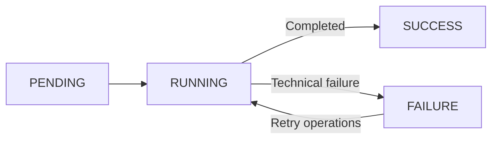

# RDP operations

RDP operations are processing steps that run after an **[RDP](../index.md)** is created and before it can be pushed to HOPE Core.

Operations run independently and keep their own configuration, status, attempts, findings, and errors. The RDP remains `PENDING` until all configured operations complete successfully.

## Supported operations

| Operation | Availability | Purpose |
| --- | --- | --- |
| **[OCR](ocr.md)** | Enabled for every Program | Checks identity-document images against the expected document number. |
| **[Biometric deduplication](deduplication.md)** | Enabled by Program configuration | Checks beneficiary photos for duplicates and image-quality problems. |

## Configuration

During **[RDP creation](../create.md#configure-rdp-processing)**, Country Workspace shows the configuration for each operation enabled for the selected Program.

Each operation stores its own settings. These settings are reused when the operation is retried and are also used to determine whether its findings require **[manual review](../review.md)**.

OCR and biometric deduplication support **Number of findings** and **Findings rate** thresholds. The rate denominator is operation-specific; see the corresponding operation page for details. The default is **Number of findings = 0**, so any finding requires manual review unless the threshold is changed.

## Processing

Each configured operation starts in `PENDING` and is processed independently.

A technical failure changes the operation to `FAILURE`. Business findings do not: an operation can complete with `SUCCESS` and still produce findings that require review.

Country Workspace continues the RDP workflow only after all configured operations are `SUCCESS`.

See **[RDP processing flow](../processing.md)** for the complete end-to-end workflow.

## Operation statuses

| Status | Meaning |
| --- | --- |
| `PENDING` | Waiting to start or to continue after recovery. |
| `RUNNING` | Processing is in progress. |
| `SUCCESS` | Processing completed successfully, with or without findings. |
| `FAILURE` | Processing failed and requires recovery. |

Use **Retry operations** for failed or otherwise recoverable operations. Failed operations are retried first; if none have failed, a `RUNNING` operation that supports manual recovery can be restarted. Operation-specific completed work is preserved where supported.

See **[OCR](ocr.md#recovery)** and **[Biometric deduplication](deduplication.md#failed-biometric-operation)** for operation-specific behavior.

## Findings and review

OCR and biometric deduplication store their adverse business results as operation findings.

After all configured operations complete successfully, Country Workspace evaluates each operation threshold independently. If any threshold is exceeded, the RDP moves to `REVIEW_PENDING`; otherwise it continues automatically to the **[HOPE Core push](../push.md)**.

The workspace provides a shared Findings view with filtering and pagination. Findings are also summarized on relevant Individual and Household pages. When an RDP is opened explicitly, the summaries show findings from that RDP; normal Program-wide views show the latest relevant findings by operation type.

See **[Review and Clean RDP](../review.md)** for review decisions and **[OCR](ocr.md#findings)** or **[Biometric deduplication](deduplication.md#findings)** for operation-specific findings.

## Operation details

The RDP page contains an **Operations** section for all configured operations.

It shows the operation type and identifier, status, timing, number of attempts, configuration, last error, execution log, saved finding count, and affected Individual count where applicable.

Use the finding count to open the detailed Findings view for that operation.
