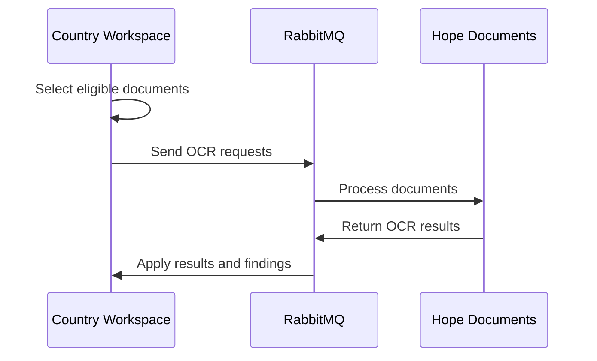

# OCR

OCR checks identity-document images before an **[RDP](../index.md)** can be pushed to HOPE Core.

It runs as an **[RDP operation](index.md)** for every Program. Country Workspace sends document requests to Hope Documents through RabbitMQ and applies the returned results to the RDP operation.

## Configuration

When creating an RDP, Country Workspace shows the OCR findings threshold.

The threshold can be configured as **Number of findings** or **Findings rate**. The rate is calculated per 100 Individuals with an OCR document selected for the operation.

See **[Create an RDP](../create.md)** for the creation flow and **[Review and Clean RDP](../review.md)** for how thresholds affect the RDP.

## Documents

OCR processes at most one identity document per Individual.

Country Workspace selects the first supported document that has both a document number and an image. That document type remains associated with the Individual for the operation, including subsequent retries.

Individuals without an eligible document are not included in OCR processing. For household-based Programs, external collectors referenced by a Household are not included in OCR processing. If the RDP has no eligible OCR documents, the OCR operation completes successfully without findings.

## Processing

OCR starts automatically as part of normal RDP processing.

Requests may be split into transport batches, but OCR completion is based on the persisted per-Individual work rather than on RabbitMQ batch delivery.

The RDP remains `PENDING` until OCR and any other configured **[RDP operations](index.md)** complete successfully.

## Findings

OCR produces two adverse finding types:

| Finding | Meaning |
| --- | --- |
| `NO_MATCH` | OCR completed, but the expected document number was not found in the image. |
| `OCR_ERROR` | Hope Documents returned an OCR processing error for the document. |

Both are valid OCR outcomes. They create findings but do not by themselves represent a technical failure of the OCR operation.

A successful match creates no adverse finding.

OCR findings are available through the shared **[RDP Findings UI](index.md#findings-and-review)** and participate in the OCR review threshold.

## Recovery

Completed OCR work is preserved across retries. Recovery processes only work that still needs to be completed.

While OCR is `RUNNING`, the **Operations** section shows **Processed** and **Last result**. **Processed** includes completed work preserved from earlier attempts, while **Last result** reflects only the current attempt. For a failed OCR operation, **Processed** remains available.

Use **Retry operations** when the OCR operation fails or when a running OCR attempt is no longer expected to complete normally. Results belonging to an earlier attempt are ignored safely.

If a document selected for OCR is no longer available when it needs to be processed again, the affected work fails instead of silently selecting a different document.

See **[Troubleshooting](../troubleshooting.md)** for recovery guidance.

## Review

After all configured operations complete successfully, Country Workspace evaluates the OCR threshold independently from other operation thresholds.

If the OCR threshold is exceeded, the RDP moves to `REVIEW_PENDING`. OCR findings can then participate in **Create clean RDP** decisions together with findings from other exceeded operations.

See **[Review and Clean RDP](../review.md)** for the available review decisions.
