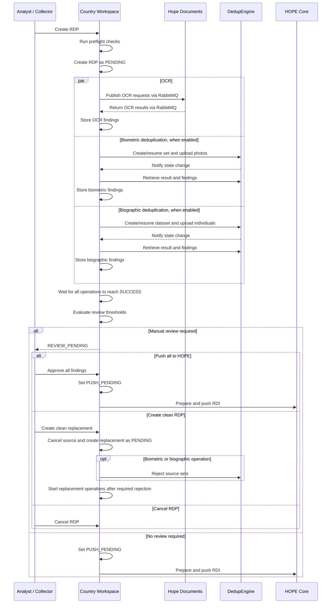

# RDP processing flow

This page shows how an **[RDP](index.md)** moves from creation through its configured **[RDP operations](operations/index.md)**, review, and the **[HOPE Core push](push.md)**.

For RDP status transitions, see **[Lifecycle and statuses](lifecycle.md)**.

## Processing sequence

## Operation processing

The configured operations are created with the RDP and run independently. **[OCR](operations/ocr.md)** sends identity documents to Hope Documents through RabbitMQ, while **[biometric](operations/deduplication.md)** and **[biographic](operations/biographic-deduplication.md)** deduplication use DedupEngine when enabled for the Program.

A technical operation failure leaves the RDP in `PENDING` and prevents it from continuing. Use **Retry operations** for failed or otherwise recoverable operations; the RDP is evaluated for the next step only after all configured operations reach `SUCCESS`.

See **[RDP operations](operations/index.md)** for the common operation lifecycle and recovery behavior.

## Findings and review

An operation can complete successfully while still producing findings.

After all operations succeed, Country Workspace evaluates each operation's review threshold independently. If any threshold is exceeded, the RDP moves to `REVIEW_PENDING`; otherwise the push starts automatically.

From review, the user can push all beneficiaries, create a clean replacement RDP using selected operation findings, or cancel the RDP. See **[Review and Clean RDP](review.md)** for the complete decision flow.

## Push to HOPE Core

When the current RDP is approved to continue, it changes to `PUSH_PENDING`.

Country Workspace prepares HOPE Core, including any required previous-RDI reset, runs push preflight validation, creates a new RDI, sends the beneficiary data, and completes the RDI. A successful push changes the RDP to `SUCCESS`; a failed push attempt changes it to `FAILURE` and can be retried.

See **[Push to HOPE Core](push.md)** for the detailed push flow and **[Recover a stuck push](lifecycle.md#recover-a-stuck-push)** for recovery from an interrupted push.
