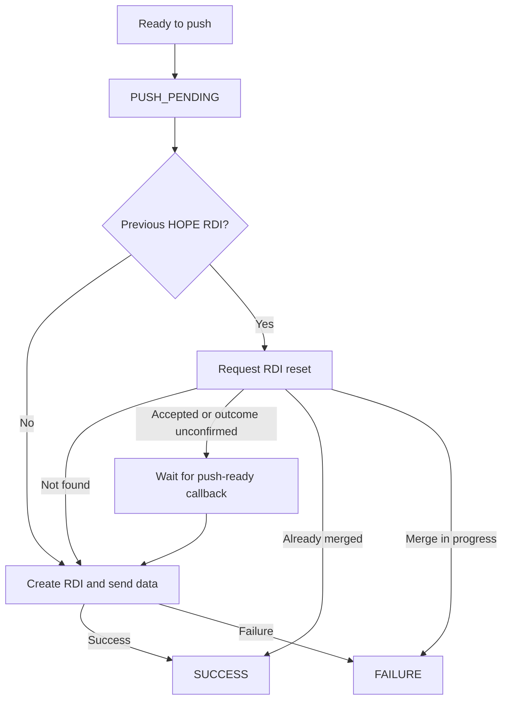

# Push to HOPE Core

Pushing an **[RDP](index.md)** transfers its beneficiary records from Country Workspace to HOPE Core as a Registration Data Import (RDI).

The push starts automatically after all required **[RDP operations](operations/index.md)** succeed when no manual review is required. From `REVIEW_PENDING`, **Push all to HOPE** starts the same push flow after explicit approval.

See **[Review and Clean RDP](review.md)** for review decisions.

## Push flow

When the RDP is ready to continue, Country Workspace changes its status to `PUSH_PENDING`.

The RDP remains `PUSH_PENDING` while Country Workspace prepares HOPE Core, waits for a reset callback when necessary, or transfers beneficiary data.

See **[Lifecycle and statuses](lifecycle.md)** for the complete RDP state flow.

## Prepare HOPE Core

If the RDP has no previous HOPE RDI, Country Workspace can proceed directly to the data push.

When a previous RDI exists, Country Workspace requests its reset. If HOPE accepts the reset, or Country Workspace cannot confirm the reset outcome, the RDP remains `PUSH_PENDING` and waits for the push-ready callback.

If HOPE reports that the previous RDI does not exist, Country Workspace can proceed directly to the data push. If the RDI was already merged, the RDP completes as `SUCCESS` without sending the beneficiary data again. If its merge is still in progress, the push attempt changes to `FAILURE`.

## Send beneficiary data

Before sending data, Country Workspace runs push preflight validation. When it succeeds, Country Workspace creates a new RDI, sends the beneficiary records, and completes the RDI.

This reuses the beneficiary validation described in **[Before creating an RDP](create.md#before-creating-an-rdp)**.

For household-based Programs, Individuals are sent before Households. For people-only Programs, People are sent directly.

A processing error during this stage changes the RDP to `FAILURE`.

## Retry a failed push

An RDP in `FAILURE` can be retried with **Retry push to HOPE** after the cause of the failure has been resolved.

Retry creates a new push attempt, returns the RDP to `PUSH_PENDING`, and repeats the HOPE preparation flow. Any previous RDI is handled before new beneficiary data is sent.

All **[RDP operations](operations/index.md)** must have completed successfully before the push can be retried.

See **[Recover a stuck push](lifecycle.md#recover-a-stuck-push)** if an active push remains in `PUSH_PENDING` and can no longer continue.

## Collectors

When a selected Household references an Individual as Primary or Alternate Collector, Country Workspace includes that Individual in the push whether or not the collector is a Household member.

If several Households reference the same collector, that Individual is sent once. A collector included only through these references is not marked as removed after a successful push.

See **[External collectors](../data_import/sources/kobo.md#external-collectors)** for source-specific details.

## After a successful push

After a successful push, Country Workspace stores the HOPE RDI ID and changes the RDP to `SUCCESS`.

For household-based Programs, the selected Households and their members are marked as removed. For people-only Programs, the selected People are marked as removed.

When **[biometric](operations/deduplication.md)** or **[biographic](operations/biographic-deduplication.md)** deduplication is configured, Country Workspace also attempts to approve the associated DedupEngine sets. An approval failure is recorded but does not change the RDP from `SUCCESS`.

See **[Troubleshooting](troubleshooting.md)** if the push does not complete as expected.
