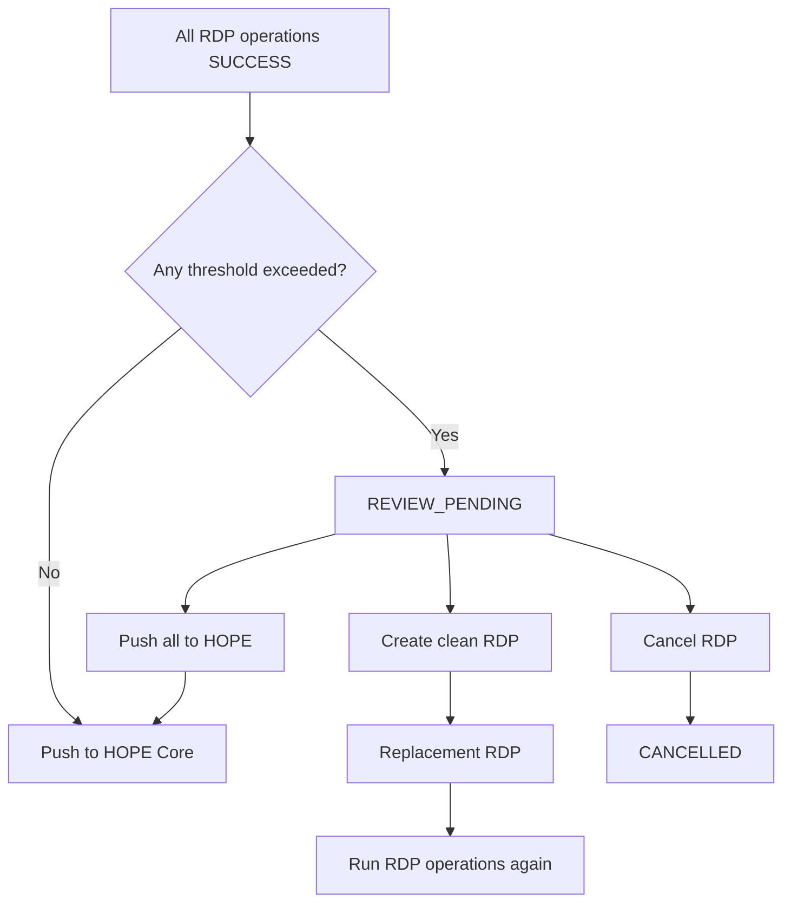

# Review and Clean RDP

After all configured **[RDP operations](operations/index.md)** complete successfully, manual review is required if one or more operations exceed their configured findings threshold.

Country Workspace evaluates each operation independently. If no threshold is exceeded, the RDP continues automatically to the **[HOPE Core push](push.md)**. Otherwise, it moves to `REVIEW_PENDING`.

See **[OCR](operations/ocr.md#review)** and **[Biometric deduplication](operations/deduplication.md#review)** for operation-specific findings and threshold calculation.

## Review decisions

From `REVIEW_PENDING`, the user can choose one of three outcomes:

| Decision | Result |
| --- | --- |
| **Push all to HOPE** | Accept the exceeded findings and continue with all beneficiaries. |
| **Create clean RDP** | Create a replacement RDP after deciding which exceeded operation findings should remove affected beneficiaries. |
| **Cancel RDP** | Cancel the current RDP without creating a replacement. |

**Push all to HOPE** is the full-review override. The RDP continues to `PUSH_PENDING` with its existing beneficiary selection.

See **[Push to HOPE Core](push.md)** for the subsequent push flow and **[Lifecycle and statuses](lifecycle.md)** for status transitions.

## Create clean RDP

**Create clean RDP** shows only operations whose thresholds were exceeded. All are selected by default, and at least one must remain selected.

For each exceeded operation, the user decides whether its findings should clean the beneficiary selection:

| Selection | Replacement behavior |
| --- | --- |
| Checked | Beneficiaries affected by that operation's findings are excluded. Its replacement threshold becomes **Number of findings = 0**. |
| Unchecked | The operation does not exclude beneficiaries by itself. Its replacement threshold becomes the number of findings that still apply after the selected cleanups. |

Operations whose thresholds were not exceeded keep their original configuration.

For household-based Programs, excluding an affected Individual excludes the whole Household. For people-only Programs, the affected Individual is excluded directly.

Findings associated only with beneficiaries already removed by another selected operation no longer affect the remaining selection.

## Replacement RDP

After the decisions are validated, the source RDP changes to `CANCELLED` and Country Workspace creates a new `PENDING` RDP from the remaining beneficiaries.

The replacement RDP keeps all configured **[RDP operations](operations/index.md)** and runs them again using the adjusted review thresholds.

For a selected operation, any new finding can require review again because its threshold is reset to `0`. For an unchecked exceeded operation, the adjusted threshold accepts the reviewed findings that still apply to the replacement selection, while additional findings can trigger review again.

If biometric deduplication is configured, Country Workspace also rejects the source **[Deduplication Set](operations/deduplication.md#deduplication-set-lifecycle)** before processing of the replacement RDP continues.

Creation is blocked if no beneficiaries would remain, or if the operation results or beneficiary selection changed while the review decision was being made.

## Cancel from review

**Cancel RDP** changes the reviewed RDP to `CANCELLED` without creating a replacement.

For biometric RDPs, Country Workspace also handles DedupEngine cleanup when required.

See **[Cancel an RDP](lifecycle.md#cancel-an-rdp)** for the general cancellation rules.
